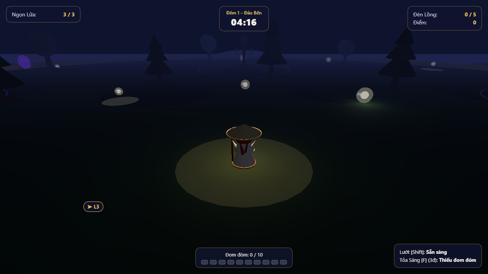

# Đảo Đèn Lồng — Ba Hòn Đảo (`v1.0.0`, Contract `v1.3`)

Game phiêu lưu 3D góc nhìn thứ ba qua **3 Đêm**: **Đêm 1 – Đảo Bến**, **Đêm 2 – Đảo Cau**, **Đêm 3 – Đảo Chuông**. Điều khiển **Mây** (tay cầm lồng đèn giấy ấm áp) thu thập đom đóm, thắp sáng và giữ dầu cho các Đèn Lồng Lớn, né Bóng Mực và Gió Lạc cho tới bình minh.

> **Video demo (`00:43`, < 5 phút):** [docs/demo/demo.mp4](docs/demo/demo.mp4) (đồng thời đính kèm tại **GitHub Release `v1.0.0`**) · **Ảnh gameplay:** [gameplay-1280x720.png](docs/proof/phase-2/gameplay-1280x720.png)
> **Tài liệu SDLC:** [Phase 1](docs/notes/phase-1.md) · [Phase 2](docs/notes/phase-2.md) · [Phase 3 ADR](docs/notes/phase-3-adr.md) · [Retro 4 Phase](docs/notes/retro.md) · [CHANGELOG](CHANGELOG.md) · [CREDITS](CREDITS.md) · [LICENSE](LICENSE)



---

## Yêu cầu hệ thống & Chạy từ clone sạch (2 lệnh)

- **Hệ điều hành:** Windows, macOS hoặc Linux.
- **Môi trường:** **Node.js `>= 22.12`** (khuyến nghị `22.23+`), trình duyệt có WebGL (Chrome/Edge/Firefox). Puppeteer đi kèm trong `npm install` để chạy `bench.js`.

```bash
npm install && npm run build
npm start
```

Mở trình duyệt tới **`http://localhost:4173`** (hoặc dùng `PORT=8080 npm start`).
*Tùy chọn Docker:* `docker build -t dao-den-long . && docker run -p 4173:4173 dao-den-long`.

---

## Điều khiển & Hỗ trợ tiếp cận (Accessibility)

Toàn bộ phím dưới đây **đều có thể đổi lại** trong mục Cài đặt tại Menu (tự phát hiện trùng phím và có nút **Khôi phục mặc định**):

| Phím mặc định | Tác dụng |
|---|---|
| `W A S D` / `Mũi tên` | Di chuyển Mây theo hướng camera (`6.0 m/s`, `7.2 m/s` khi có Bùa Gió) |
| Kéo chuột trái hoặc `Q` / `C` | Xoay camera ngang và kéo dọc / cuộn chuột để nhìn từ trên xuống |
| `Space` | Nhảy (`7.0 m/s`, chỉ khi chạm đất) |
| `Shift` | **Lướt (Dash):** `14 m/s` trong `0.2 s` (giữ độ cao trên không, hồi chiêu `1.5 s`) |
| `E` | Thắp đèn (`10` mới / `5` thắp lại) hoặc **châm dầu** (`+10 fuel`/đom đóm, `<= 2.0 m`) |
| `F` | **Tỏa Sáng (Pulse):** tốn `3` đom đóm, đẩy `4 m` & choáng `2 s` Bóng Mực trong `5 m` |
| `Click chuột trái` hoặc `J` / `X` | **Chém ánh sáng (3D):** đẩy lùi & làm choáng Bóng Mực trước mặt **`3.0 s` (`180` tick)** |
| `Esc` hoặc `P` | Tạm dừng / Tiếp tục (`paused`) |

**Tính năng Accessibility tích hợp sẵn:**
- **Cỡ chữ UI:** Tối thiểu **`18 px`** ở `1280×720`, hỗ trợ tùy chọn **Chữ lớn (`×1.25`)**.
- **Phụ đề & chỉ báo hình ảnh:** Hiện cảnh báo trực quan khi **Bóng Mực xuất hiện** (kèm mũi tên tím chỉ hướng ở mép màn hình), **gió sắp thổi**, **`10 s` cuối**, và **đèn `fuel < 30`**.
- **Giảm chuyển động:** Tắt rung camera và hiệu ứng chớp màn hình.
- **Bảng màu dễ phân biệt (Mù màu):** Đổi sắc Bóng Mực sang `#00B3FF`, cảnh báo sang `#FFFFFF + ⚠`, đèn tắt bị xẹp `20%` và hiện vết rách.

---

## Luật chơi & Cách tính điểm (`Contract v1.3`)

- **Luật thắng:** Sống sót tới **bình minh** (Đêm 1/2/3: `240 / 270 / 300 s`) với số đèn sáng **`>= ceil(0.6 * tổng đèn)`** (`3/5`, `4/6`, `5/7` -> `dawn_survived`). Đèn sáng hao `1 fuel/s`; dưới `30 fuel` mất vùng an toàn và Bóng Mực `wander` có thể vào `drain` `5 fuel/s`.
- **Sức chứa tăng dần:** `min(20, 10 + 2 * successful_lights)` mỗi Đêm.
- **Điểm số:** `+5` mỗi đom đóm nạp, `+100` thắp mới, `+40` thắp lại, `+5` Tỏa Sáng (`+15` khi cắt `drain`), cộng thưởng bình minh `+50 + floor(fuel)` mỗi đèn sáng và `+50` mỗi Ngọn Lửa còn lại.
- **Bảng xếp hạng cục bộ:** Lưu Top 10 bền vững xuống đĩa (`~/.dao-den-long/leaderboard.json`), hỗ trợ tên `3–12` ký tự (`A-Z`, `a-z`, `0-9`, `_`, tiếng Việt có dấu).

---

## Kiểm thử, Headless, Benchmark, Soak & Xuất Leaderboard

```bash
# 1. Toàn bộ 23 unit/contract/regression/phase-4 tests
npm test

# 2. Chế độ Headless tất định (60 tick/s, không sáng tạo thêm)
node src/headless/cli.js --seed 42 --night 3 --ticks 21600 --out out.jsonl

# 3. Chế độ Soak Test (10 Đêm xoay vòng 1->2->3 cùng tiến trình)
node src/headless/soak.js --seed 7 --nights 10 --out soak.json

# 4. Benchmark 3D 1280x720 (tắt vsync qua --disable-gpu-vsync, 200 Bóng Mực + 100 đom đóm)
node src/bench/bench.js --seed 42 --duration 30 --out bench.json

# 5. Xuất bảng xếp hạng cục bộ ra JSON
node src/server/run.js --export-leaderboard out.json
```

> **Ghi chú kỹ thuật Benchmark (`bench.json`):**
> - Lệnh `bench.js` chạy Puppeteer Chromium với `--disable-gpu-vsync` (`vsync_off: true`) tại độ phân giải `1280×720`, bỏ `3 s` đầu và đo đúng `30 s`.
> - Trên bản web chạy trong sandbox trình duyệt, `peak_mem_mb` được đọc từ `performance.memory.usedJSHeapSize` (JS heap của renderer Chromium, ví dụ `15.6 MB` trong [bench.json](bench.json)), không bao gồm bộ nhớ ngoài V8/GPU driver của hệ điều hành.
> - Kết quả đo trực tiếp trên máy phát triển (Intel Iris Xe Graphics, Windows): **`avg_fps: 59.1`**, **`p1_low_fps: 30`**, **`frame_ms_p95: 16.8 ms`**, **`load_ms: 849 ms`**. Xem thêm [soak.json](soak.json) (`crashes: 0`, `44.1 -> 48 MB`).

---

## Sáng tạo của tôi

Toàn bộ các mở rộng nghệ thuật & trải nghiệm dưới đây chỉ chạy ở chế độ chơi 3D (`creativeVariants: true`, lớp `src/game/`), **tắt hoàn toàn trong chế độ Headless (`cli.js`, `soak.js`, `creativeVariants: false`) và Benchmark (`benchmarkMode: true`)** nên không làm thay đổi hay sai lệch bất kỳ đầu ra nào của **Test Contract v1.3** (đã kiểm chứng qua `23/23` test tự động trong `tests/contract.test.js`, xem thêm [docs/proof/phase-4/README.md](docs/proof/phase-4/README.md)):

- **Live 3D Orbit Menu & Hội thoại hướng dẫn cùng "Đăng":** Menu chính dựng trực tiếp cảnh Đêm 1 sống động với camera quay vòng tròn mượt mà quanh Đảo Bến (`menuOrbit`, tôn trọng `reduced-motion`); khi vào mỗi Đêm, nhân vật dẫn đường **Đăng** (chân dung SVG vector tải tức thì) xuất hiện với hộp thoại `3` bước chạy chữ, tự đọc phím thực tế từ `settings.keybinds`, hỗ trợ `Space`/`Enter` và nút **Bỏ qua hướng dẫn**.
- **Ánh sáng vật lý theo nguồn sáng & Sương đêm giảm dần theo khoảng cách:** Giữ nền đêm sâu `#0E1430` khi xa nguồn sáng (`THREE.Fog` tối dần vào màu trời đêm), nổi bật ánh sáng ấm cục bộ quanh **lồng đèn cầm tay của Mây**, **Đèn Lồng Lớn** (bán kính & cường độ tỉ lệ theo `fuel`, vòm & cột sáng 3D), và **đom đóm**.
- **Cảnh quan sinh thái & Sông suối chảy liền mạch:** Sông suối uốn lượn liên tục (`CatmullRomCurve3` + UV scroll) cùng sông nhánh, **ao hồ tự nhiên** có bờ đá & hoa sen/lá sen, **thảm cỏ 3D `InstancedMesh`** đung đưa theo gió (`onBeforeCompile`), và nhiều loài cây/màu sắc đa dạng (tán tròn, thông tầng, cau, cây lá thu, bụi hoa đêm phát sáng) giữ nguyên vùng va chạm chuẩn của `src/sim/maps.js`.
- **Tạo hình Mây, Bóng Mực nhiều lớp có Eye Tracking & Cảnh điện ảnh Bình Minh:** Mây đội nón lá cầm lồng đèn giấy; **Bóng Mực** (`InstancedMesh`) có áo choàng rách nhiều tầng, cầu vai, sừng cong, `6` tua mực xoay động, biểu hiện `drain`/`stunned` và **cụm mắt + đồng tử tách riêng luôn liếc theo vị trí Mây**. Khi thắng Đêm (`dawn_survived`), kích hoạt **cảnh Bình Minh 3D** (`4.2 s`, có thể bấm bỏ qua nhanh): mặt trời mọc từ chân trời, bầu trời chuyển đêm → tím rạng đông → cam vàng ấm áp, Bóng Mực tan biến.
- **Đom đóm 3 kích cỡ biết bay & Chém ánh sáng `3.0 s` + Thanh Dev:** Đom đóm Nhỏ (`+1`, đứng yên), Vừa (`+2`, bay `1.5 m/s`) và Lớn (`+3`, bay `2.6 m/s`) bám đúng bề mặt tầng/dốc, kỹ năng **Chém ánh sáng** làm choáng Bóng Mực `180` tick (`3.0 s`), cùng thanh công tắc Dev chọn nhanh Đêm 1/2/3 hoặc rút gọn giờ test thủ công (mặc định tắt).
